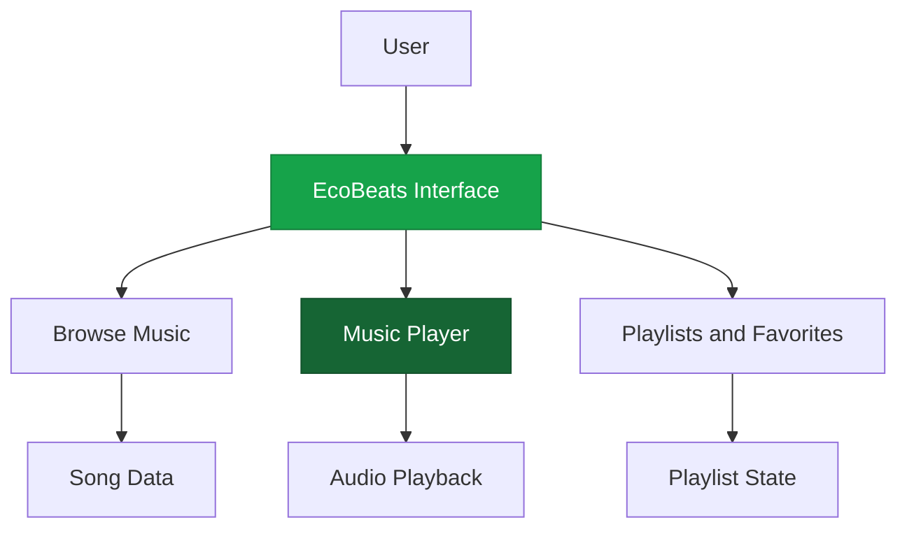

# 🎧 EcoBeats — Feel the Rhythm. Live the Vibe.

<p align="center">
  
</p>

<p align="center">
  <strong>A modern music streaming experience built with creativity and code.</strong>
</p>

<p align="center">
  <a href="https://github.com/Rutik2905/ecobeats-by-Rutik-and-Krishna-Playlist">
    
  </a>
  
  
</p>

<p align="center">
  <a href="#-about-the-project">About</a> •
  <a href="#-features">Features</a> •
  <a href="#-tech-stack">Tech Stack</a> •
  <a href="#-getting-started">Installation</a> •
  <a href="#-project-structure">Structure</a> •
  <a href="#-contributors">Contributors</a>
</p>

---

## 📖 About the Project

**EcoBeats** is a music streaming web application developed by **Rutik Gharmode and Krishna**. It aims to deliver an enjoyable music-listening experience through a modern interface, intuitive navigation, and music-focused design.

The project is inspired by modern streaming platforms and is being developed as a practical web development project to explore frontend technologies, UI design, and interactive web experiences.

> 🎶 Discover your vibe. Press play. Let the music flow.

## ✨ Features

- 🎵 Music-focused user interface
- 🎧 Music browsing and playback *(as implemented)*
- ❤️ Favorite songs and playlist management *(if implemented)*
- ⏯️ Playback controls *(if implemented)*
- 📱 Responsive design for different screen sizes
- 🌿 Unique EcoBeats branding and visual identity

> **Note:** The features above describe the intended project scope. Update this list to match the functionality available in your current code.

## 🛠️ Tech Stack

| Technology | Purpose |
|---|---|
| HTML | Web page structure |
| CSS | Styling and responsive layouts |
| JavaScript | Interactivity and application logic |
| React | Component-based UI, if used |
| Vite | Development server and build tool, if used |

## 🚀 Getting Started

Follow these steps to run EcoBeats locally.

### Prerequisites

- [Node.js](https://nodejs.org/) installed
- npm package manager
- [Git](https://git-scm.com/) installed

### 1. Clone the repository

```bash
git clone https://github.com/Rutik2905/ecobeats-by-Rutik-and-Krishna-Playlist.git
```

### 2. Navigate to the project

```bash
cd ecobeats-by-Rutik-and-Krishna-Playlist
```

If your application is inside a `frontend` folder, run:

```bash
cd frontend
```

### 3. Install dependencies

```bash
npm install
```

### 4. Start the development server

```bash
npm run dev
```

Open the local URL shown in your terminal, usually `http://localhost:5173`.

<details>
<summary><strong>⚡ Troubleshooting</strong></summary>

**Problem: `npm` is not recognized**

Install Node.js from [nodejs.org](https://nodejs.org/), restart the terminal, and check:

```bash
node -v
npm -v
```

**Problem: `npm run dev` fails**

Check whether `package.json` exists in your current directory. If it does, inspect its `scripts` section to confirm the correct development command.

**Problem: Dependencies are missing**

Run:

```bash
npm install
```

Then try starting the development server again.

</details>

## 🏗️ Project Architecture

The following diagram illustrates a typical frontend music application architecture.



*This is a conceptual diagram; adapt it to your actual implementation.*

## 📂 Project Structure

A typical React and Vite project may look like this:

```text
ecobeats/
├── public/
├── src/
│   ├── assets/
│   ├── components/
│   ├── App.jsx
│   ├── App.css
│   └── main.jsx
├── index.html
├── package.json
├── package-lock.json
├── vite.config.js
└── README.md
```

Your actual folders and filenames may differ.

## 🖼️ Screenshots

Add screenshots of your real application here to help visitors explore the design.

```md
<!-- Add screenshots to your repository first. -->
<!-- Example:  -->
```

<details>
<summary><strong>📌 Future Enhancements</strong></summary>

- [ ] Search songs and artists
- [ ] Create and manage playlists
- [ ] Add favorite tracks
- [ ] Improve mobile responsiveness
- [ ] Integrate a music API or backend, if needed
- [ ] Add user authentication, if needed
- [ ] Deploy the application online

</details>

## 👨‍💻 Contributors

<table>
  <tr>
    <td align="center">
      <a href="https://github.com/Rutik2905">
        
        <br/>
        <strong>Rutik Gharmode</strong>
      </a>
      <br/>
      Project Developer
    </td>
    <td align="center">
      <strong>Krishna</strong>
      <br/>
      Project Developer
    </td>
  </tr>
</table>

## 🤝 Contributing

Suggestions and improvements are welcome!

1. Fork the repository.
2. Create a feature branch.
3. Make your changes.
4. Commit your work.
5. Open a pull request.

## 📄 License

This project is intended for educational and portfolio purposes. Add a `LICENSE` file if you wish to publish it under a specific open-source license.

## 💚 Support the Project

If you like EcoBeats, consider giving the repository a ⭐ on GitHub.

<p align="center">
  <strong>Made with ❤️, music, and code.</strong>
  <br/>
  <sub>EcoBeats — by Rutik Gharmode and Krishna</sub>
</p>

<p align="center">
  
</p>
